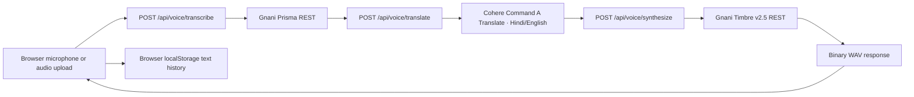

# LingOSwap — Voice Without Borders

**Every language deserves a voice. Every voice deserves to be understood.**

LingOSwap is a multilingual voice translation demo built on the original Next.js LingOSwap codebase. It records or accepts a short audio clip, transcribes it with Gnani Prisma, translates the text with a separate language model, then generates speech with Gnani Timbre.

## What works in this codebase

- Voice recording exported as WAV in the browser, or upload of WAV, MP3, OGG, FLAC, AAC, and M4A.
- A server route validates file type/size/duration and calls Gnani Prisma STT (`/stt/v3`).
- A separate Cohere Command A Translate route for Hindi ↔ English. Prisma is speech recognition and Timbre is speech synthesis; neither is presented as a translation model.
- A server route calls Gnani Timbre v2.5 and returns playable WAV audio for playback/download.
- Language matched voice selection for the documented language catalog.
- Text transcript and translation history stored in browser localStorage; raw recordings and audio output are not persisted by LingOSwap.
- Existing Cohere generational slang rewriter is retained as a separate optional tool.
- Responsive dark interface, recording/processing/error states, audio controls, copy, retry, and history clearing.

The repository did not contain an authentication system or database before this work. This version therefore does not claim authenticated accounts, cloud history, or user-specific server storage. Production deployment must configure persistent rate limiting (Upstash/Vercel KV). Do not treat the in-process local development limiter as production protection.

## Stack and architecture

- Next.js 15 App Router, React 18, TypeScript, Tailwind CSS.
- API routes call Gnani from the server; `GNANI_API_KEY` is never read by client components.
- Voice translation uses Cohere Chat v2 with `command-a-translate-08-2025`, through the server-side `COHERE_API_KEY`. The legacy OpenAI helper remains separate and is not required for the voice pipeline.
- Browser history is local only. No database is configured.



## Run locally

Requirements: Node.js 20 or newer and npm.

```bash
npm ci
cp .env.example .env.local
```

Set these server-side in `.env.local` (or your deployment secret manager):

```dotenv
GNANI_API_KEY=your_gnani_api_key
COHERE_API_KEY=your_cohere_api_key
```

For production voice endpoints, configure `KV_REST_API_URL` and `KV_REST_API_TOKEN` for persistent rate limiting. Never place these secret values in `NEXT_PUBLIC_*` variables or commit `.env.local`.

```bash
npm run dev
```

Open [http://localhost:3000](http://localhost:3000).

## Supported languages and models

The voice models document ten BCP-47 Indian language codes. The complete UI translation flow currently enables Hindi (`hi-IN`) ↔ English (`en-IN`) because these are the supported pair within Cohere Command A Translate's documented 23 languages. Other Prisma/Timbre locales are shown as disabled in the flow; they are not claimed as fully translated. The Prisma REST docs specify WAV, MP3, OGG, FLAC, AAC, and M4A, sample rates from 8 kHz to 44.1 kHz in Quick Start, and a maximum duration of 60 seconds (30 seconds or less ideal).

Timbre v2.5 docs list those ten languages and Hinglish (`hi-en`) with preferred voice choices. The active TTS model is `timbre-v2.5`. The public Prisma REST parameter list does not document a model field or `indic-auto`; this app sends only documented fields. Confirm current model/account access in your Gnani dashboard. See [docs/GNANI_AI_INTEGRATION.md](docs/GNANI_AI_INTEGRATION.md) for full contract details and known discrepancies.

## Tests and checks

```bash
npm test
npm run lint
npm run build
```

Vitest mocks provider responses and does not make live requests or consume Gnani credits. Separately, one live Prisma request and one live Timbre request have succeeded through the local app routes; see [the recorded verification](docs/GNANI_AI_INTEGRATION.md). The translation provider and complete browser workflow remain unverified live.

## Privacy and service requirements

- Audio is sent to Gnani for speech recognition; it is not stored in LingOSwap history.
- Transcript text and selected languages are sent to the configured translation provider.
- The translated text, voice, and language are sent to Gnani for speech generation.
- Recent transcript/translation text is kept in browser localStorage on this device only.
- The API currently has no login/authentication layer because none existed in the supplied project. Endpoints use request validation and rate limits but are not user-authenticated.
- A complete privacy/compliance review of provider retention and deployment location is outside the current code verification.

## Challenge demo materials

The implementation checklist, limitations, and smoke-test notes are in [docs/GNANI_AI_INTEGRATION.md](docs/GNANI_AI_INTEGRATION.md). A concise demo narration and social announcement draft are in [docs/CHALLENGE_DEMO.md](docs/CHALLENGE_DEMO.md).

## Original project feature

The original Cohere-backed Gen Z/Millennial/Boomer text rewriter remains available under “Original LingOSwap text style tool.” It uses `COHERE_API_KEY` if you want to use that feature.

## Deployment

Deploy the original Next.js app to a Node-compatible Next.js host. Configure `GNANI_API_KEY`, `COHERE_API_KEY`, and persistent `KV_REST_API_URL`/`KV_REST_API_TOKEN` as server-side secrets. Do not publicly expose the current unauthenticated voice routes. Prisma and Timbre each passed one prior individual live check, and Cohere passed one authorized Hindi-to-English route check. The full browser workflow, mobile experience, and production security remain unverified; this project is not production-ready.
