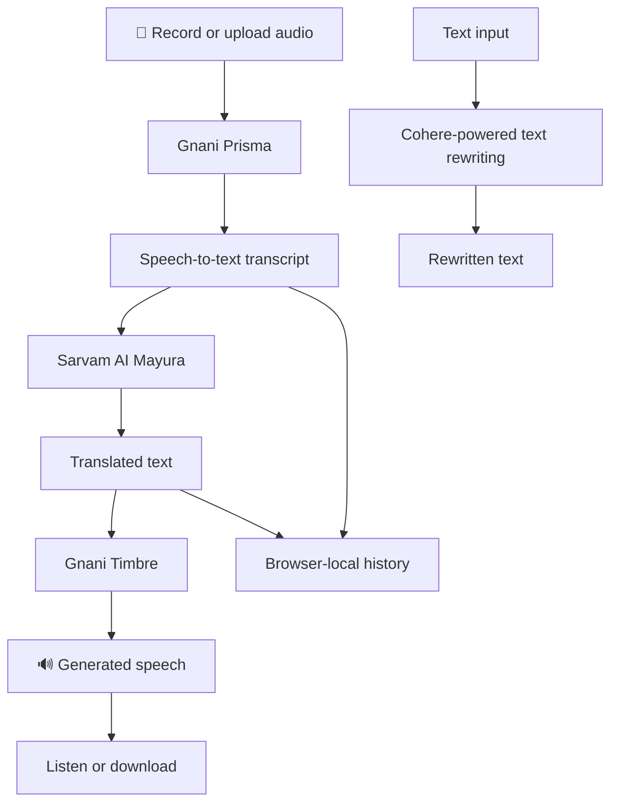

# Lingo Voice 🌍🎙️
### Voice Without Borders — Listen. Understand. Speak.

<p align="center">
  <strong>Every language deserves a voice. Every voice deserves to be understood.</strong>
</p>

<p align="center">
  An AI-powered multilingual voice translation experience that brings speech recognition, intelligent translation, and natural speech generation together in one seamless workflow.
</p>

<p align="center">
  <a href="https://lingo-voice-zeta.vercel.app"><strong>🚀 Live Demo</strong></a>
  &nbsp;·&nbsp;
  <a href="https://github.com/ManyaValecha/lingo-voice"><strong>💻 Source Code</strong></a>
</p>

<p align="center">
  
  
  
  
  
  
  
</p>

---

## 📸 The experience

<p align="center">
  
</p>

<p align="center">
  
</p>

---

## 🌱 The vision

Language should never be the reason someone cannot communicate.

Imagine travelling to a new place, speaking with someone from another culture, or simply trying to understand a conversation in a language you do not know.

**Lingo Voice** is built around a simple idea: make communication across languages feel natural.

It brings three AI capabilities together:

1. **LISTEN** — Recognise spoken words from audio.
2. **UNDERSTAND** — Translate the recognised text into the selected language.
3. **SPEAK** — Turn the translated text into playable speech.

The goal is to make voice translation accessible through a simple browser-based experience.

## ✨ What makes Lingo Voice special?

- 🎤 **Speak or upload audio:** Record directly through the browser or upload an existing audio file.
- 🧠 **AI-powered speech recognition:** Convert spoken audio into text using Gnani Prisma.
- 🌍 **Multilingual translation:** Translate text using Sarvam AI's Mayura translation model.
- 🔊 **Natural speech generation:** Generate playable speech using Gnani Timbre.
- 🗣️ **Language-aware voice selection:** Use the configured language and voice options.
- 📜 **Translation history:** Revisit recent transcripts and translations stored locally in the browser.
- ✍️ **AI text rewriting:** Use the separate Cohere-powered slang rewriting feature.
- 📱 **Responsive interface:** Designed for desktop and mobile-sized screens.

## 🔄 How it works

<p align="center">
  <strong>One recording. Three AI stages. A voice that crosses language barriers.</strong>
</p>



### The AI pipeline

| Stage | Technology | Responsibility |
|---|---|---|
| Speech recognition | Gnani Prisma | Converts recorded speech into text |
| Translation | Sarvam AI Mayura v1 | Translates recognised text |
| Speech synthesis | Gnani Timbre | Generates playable speech |
| Text rewriting | Cohere API | Powers the separate slang-rewriting feature |
| Frontend | Next.js, React, TypeScript | Recording, uploading, playback and interaction |
| Local history | Browser localStorage | Stores recent transcript and translation text |

**Architecture principle:** Each AI provider has a clearly defined responsibility. Speech recognition, translation, and speech generation are separate stages rather than one opaque operation.

## 🌍 Language support

Lingo Voice uses Sarvam AI's Mayura translation model for multilingual text translation.

The application supports translation through its configured language options, subject to the language codes accepted by the translation service.

- Translation is handled through the Sarvam API.
- The application supports a maximum translation input length of 5,000 characters.
- Speech recognition and speech generation use their separately configured Gnani language and voice capabilities.

Language availability can vary by provider and operation. A language supported by speech recognition is not automatically guaranteed to be supported by every translation or speech-generation configuration.

## 🛠️ Technology stack

| Layer | Technologies |
|---|---|
| Framework | Next.js 15 App Router |
| UI | React 18, TypeScript |
| Styling | Tailwind CSS |
| Speech-to-text | Gnani Prisma |
| Translation | Sarvam AI Mayura v1 |
| Text-to-speech | Gnani Timbre |
| Text rewriting | Cohere API |
| Backend | Next.js server-side API routes |
| Browser storage | localStorage |
| Testing | Vitest |
| Deployment | Vercel |

## 🚀 Getting started

### Prerequisites

- Node.js 20 or newer
- npm
- Gnani API access
- Sarvam AI API access
- Cohere API access (for the text-rewriting feature)

### 1. Clone the repository

```bash
git clone https://github.com/ManyaValecha/lingo-voice.git
cd lingo-voice
```

### 2. Install dependencies

```bash
npm ci
```

### 3. Configure environment variables

Create your local environment file:

```bash
cp .env.example .env.local
```

Add the required credentials to `.env.local`:

```dotenv
GNANI_API_KEY=your_gnani_api_key
SARVAM_API_KEY=your_sarvam_api_key
COHERE_API_KEY=your_cohere_api_key
```

Configure any additional environment variables documented in `.env.example` for your deployment, including persistent rate-limiting credentials if required.

**Important security practices:**

- Never commit `.env.local`.
- Never expose provider credentials through `NEXT_PUBLIC_` variables.
- Keep all third-party API calls requiring secrets on the server.
- Use Vercel Environment Variables for deployment credentials.
- Never share API keys in screenshots, logs, or public repositories.

### 4. Start the development server

```bash
npm run dev
```

Open [http://localhost:3000](http://localhost:3000) in your browser.

## 🧪 Testing and verification

Run the available project checks:

```bash
npm test
npm run lint
npm run build
```

### Verification notes

| Area | Status |
|---|---|
| Next.js production build | Build previously passed |
| Sarvam translation integration | API tests passed for selected language pairs |
| Hindi → Tamil | Tested |
| Bengali → Telugu | Tested |
| Marathi → Gujarati | Tested |
| Complete browser-to-browser voice workflow | Requires full end-to-end verification |
| Production security review | Further review recommended |

Individual API tests and successful builds should not be confused with complete end-to-end verification across every supported language, device, and provider.

## 🔐 Privacy and responsible AI

Voice applications can process personal information. Lingo Voice is designed with a server-side API architecture and browser-local history.

The main data flow is:

- Audio recordings are sent to the configured speech-recognition provider.
- Recognised text and language selections are sent to the translation provider.
- Translated text and voice configuration are sent to the speech-generation provider.
- Recent transcript and translation text are stored in browser `localStorage`.
- The current implementation does not require a user account or application database for its local history feature.

Raw recordings and generated audio are not intended to be stored in the browser's translation-history records.

Users should review the relevant provider retention policies and applicable privacy requirements before using the application with sensitive information.

## ⚙️ Engineering considerations

The project focuses on keeping the application understandable, modular, and practical to extend.

Key considerations include:

- Server-side API routes for provider integrations.
- Server-side credential handling.
- Audio input validation.
- Browser-based recording and audio playback.
- Loading, success, and error handling.
- Translation input-length validation.
- Browser-local history management.
- Rate-limiting considerations for public deployment.

**Production note:** Lingo Voice is an evolving working project. Authentication, persistent production-grade rate limiting, comprehensive end-to-end testing, and a full deployment security review are areas to address before relying on it as a production-scale service.

## 📁 Project documentation

Additional technical documentation is available in the repository:

- [`docs/GNANI_AI_INTEGRATION.md`](docs/GNANI_AI_INTEGRATION.md) — Gnani provider integration details, implementation notes, and verification.
- [`docs/CHALLENGE_DEMO.md`](docs/CHALLENGE_DEMO.md) — Demo walkthrough, implementation checklist, and presentation material.

## 🔮 What's next?

The vision for Lingo Voice extends beyond a basic voice translation demo.

Potential future improvements:

- 🌏 Expand and evaluate support for more Indian and international languages.
- 🎯 Measure translation quality across different language pairs.
- 🎙️ Improve speech recognition across accents and recording conditions.
- ⚡ Reduce translation and speech-generation latency.
- 📱 Improve the mobile recording and playback experience.
- 🔐 Introduce secure accounts and optional synchronised history.
- 📊 Add comprehensive end-to-end evaluation and monitoring.
- 🛡️ Strengthen persistent rate limiting and production security.

These are development directions, not claims that the features are already implemented.

## 💜 The bigger picture

India speaks in hundreds of voices, accents, and languages.

Every conversation carries a story. Every language carries a culture. Technology should bring those worlds closer, not make communication harder.

Lingo Voice is a step towards making language a bridge rather than a barrier.

<p align="center">
  <strong>LISTEN. UNDERSTAND. SPEAK.</strong>
  <br />
  <em>Voice Without Borders.</em>
</p>

---

<p align="center">
  Built with curiosity, engineering, and a belief in accessible AI.
  <br /><br />
  <strong>Manya Valecha</strong>
  <br />
  <a href="https://github.com/ManyaValecha">GitHub</a>
  ·
  <a href="https://github.com/ManyaValecha/lingo-voice">Repository</a>
  ·
  <a href="https://lingo-voice-zeta.vercel.app">Live Demo</a>
</p>
