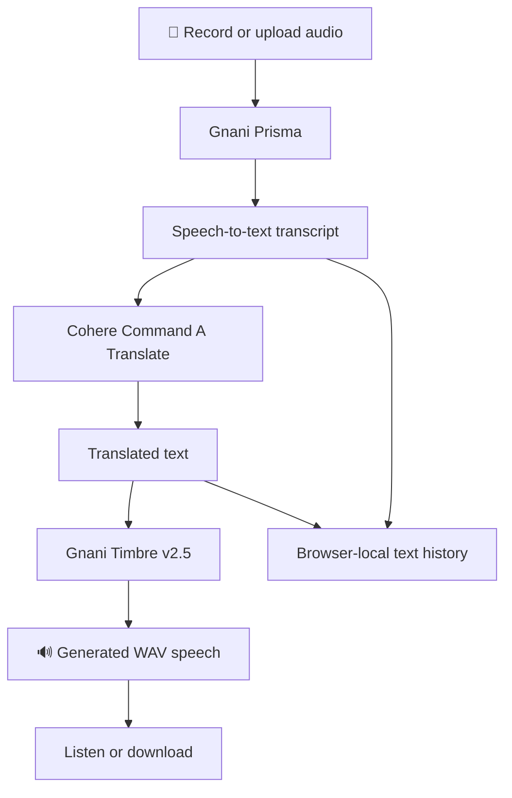

# Lingo Voice — Voice Without Borders 🌍🎙️

<p align="center">
  <strong>Every language deserves a voice. Every voice deserves to be understood.</strong>
</p>

<p align="center">
  An AI-powered multilingual voice translation experience connecting speech recognition, language translation, and natural speech generation.
</p>

<p align="center">
  
  
  
  
  
  
</p>

---

## 🌱 The vision

Language should never be the reason someone cannot communicate.

Whether someone is travelling, learning, working, or connecting across cultures, **Lingo Voice** aims to make spoken communication more accessible through AI.

Instead of treating voice translation as one black-box operation, Lingo Voice connects three distinct AI capabilities into one experience:

1. **Listen** — Recognise spoken words using Gnani Prisma.
2. **Understand** — Translate recognised text using Cohere Command A Translate.
3. **Speak** — Generate natural speech using Gnani Timbre.

The result is a browser-based voice translation workflow that transforms an audio recording into translated, playable speech.

## ✨ Key features

- 🎤 **Speak or upload:** Record directly in the browser or upload an existing audio file.
- 🧠 **AI speech recognition:** Convert audio into text using Gnani Prisma.
- 🌐 **AI translation:** Translate Hindi ↔ English using Cohere Command A Translate.
- 🔊 **Natural speech generation:** Convert translated text into playable speech using Gnani Timbre v2.5.
- 🗣️ **Language-aware voice selection:** Match voice choices to the supported language configuration.
- 📜 **Local translation history:** Revisit recent transcripts and translations stored in the browser.
- 📱 **Responsive interface:** Use the experience across desktop and mobile-sized screens.
- ✍️ **Additional text tool:** Includes a separate Cohere-powered generational slang rewriter.

## 🔄 How it works

<p align="center">
  <strong>One recording. Three AI stages. A spoken translation.</strong>
</p>



### The AI pipeline

| Stage | Technology | Responsibility |
|---|---|---|
| Speech recognition | Gnani Prisma REST API | Converts recorded speech into text |
| Translation | Cohere Command A Translate | Translates Hindi ↔ English |
| Speech synthesis | Gnani Timbre v2.5 | Generates spoken audio |
| Frontend | Next.js + React | Recording, upload, playback and interaction |
| Local history | Browser localStorage | Stores recent transcript and translation text |

**Architecture principle:** Prisma handles speech recognition, Cohere handles translation, and Timbre handles speech synthesis. Each provider has a clearly defined role.

## 🛠️ Technology stack

| Layer | Technologies |
|---|---|
| Framework | Next.js 15 App Router |
| UI | React 18, TypeScript, Tailwind CSS |
| Speech-to-text | Gnani Prisma |
| Translation | Cohere Command A Translate |
| Text-to-speech | Gnani Timbre v2.5 |
| API architecture | Next.js server-side API routes |
| Browser storage | localStorage |
| Testing | Vitest |

## 🌍 Language support

Lingo Voice uses Gnani's documented Indian-language speech capabilities while keeping the currently enabled translation experience explicit.

**Currently enabled translation pair:**

- Hindi (`hi-IN`) → English (`en-IN`)
- English (`en-IN`) → Hindi (`hi-IN`)

Other documented Prisma and Timbre language locales are not represented as fully working end-to-end translation pairs in the current UI.

Speech recognition and speech generation support do not automatically mean that a language pair is supported by the configured translation model.

## 🚀 Getting started

### Prerequisites

- Node.js 20 or newer
- npm
- Gnani API access
- Cohere API access

### 1. Clone the repository

```bash
git clone https://github.com/ManyaValecha/lingo-voice.git
cd lingo-voice
```

### 2. Install dependencies

```bash
npm ci
```

### 3. Configure environment variables

Create your local environment file:

```bash
cp .env.example .env.local
```

Add your API credentials:

```dotenv
GNANI_API_KEY=your_gnani_api_key
COHERE_API_KEY=your_cohere_api_key
```

For production voice endpoints, configure persistent rate-limiting credentials:

```dotenv
KV_REST_API_URL=your_kv_rest_api_url
KV_REST_API_TOKEN=your_kv_rest_api_token
```

**Security:** Keep API keys server-side. Never expose provider credentials through `NEXT_PUBLIC_*` variables or commit `.env.local`.

### 4. Run the application

```bash
npm run dev
```

Open [http://localhost:3000](http://localhost:3000).

## 🧪 Testing and verification

Run the project's checks:

```bash
npm test
npm run lint
npm run build
```

### Verification status

| Component | Verification |
|---|---|
| Vitest provider-mocked tests | Available; no live API credits consumed |
| Gnani Prisma | One successful individual live request through the local app route |
| Gnani Timbre | One successful individual live request through the local app route |
| Cohere translation route | One authorized Hindi-to-English route check |
| Complete browser-to-browser voice workflow | Not yet fully verified live |
| Production security and deployment | Not yet verified |

Individual provider checks should not be confused with a fully verified end-to-end workflow.

## 🔐 Privacy and responsible AI

Voice applications handle personal information, so understanding the data flow matters.

- Audio recordings are sent to Gnani for speech recognition.
- Transcript text and selected languages are sent to the configured translation provider.
- Translated text, voice selection, and language information are sent to Gnani for speech generation.
- Raw recordings and generated audio are not persisted in Lingo Voice's browser history.
- Recent transcript and translation text are stored in browser `localStorage` on the user's device.
- The current implementation does not include user authentication or a database.

Provider retention policies and deployment-specific compliance requirements should be reviewed before production use.

## ⚙️ Engineering considerations

The application includes:

- Server-side provider API calls to protect credentials.
- Audio file type, size, and duration validation.
- Browser WAV recording and audio playback/download.
- Loading, success, retry, and error states.
- Browser-local translation history management.
- Request rate limiting, with persistent KV configuration required for production.

**Production readiness:** This is a working demo, not a production-hardened service. Persistent rate limiting, authentication, full end-to-end testing, and a deployment security review remain necessary before public production use.

## 📁 Project documentation

Explore the technical documentation included in the repository:

- [`docs/GNANI_AI_INTEGRATION.md`](docs/GNANI_AI_INTEGRATION.md) — Provider integration contracts, implementation notes, verification, and known discrepancies.
- [`docs/CHALLENGE_DEMO.md`](docs/CHALLENGE_DEMO.md) — Demo narration, implementation checklist, and social announcement draft.

## 🔮 What's next?

Lingo Voice is designed to grow beyond its current Hindi–English demo.

Potential future improvements include:

- Expanding the translation pipeline to additional Indian languages.
- Testing complete end-to-end speech translation across supported devices.
- Improving speech quality, latency, and error recovery.
- Adding secure user accounts and optional synchronised history.
- Introducing persistent production-grade rate limiting.
- Evaluating translation quality and speech recognition accuracy across accents and recording conditions.

These are future development directions, not claims about features already implemented.

## 💜 The bigger picture

India speaks in hundreds of voices, accents, and languages. Technology should bring those voices closer, not make communication harder.

Lingo Voice is a step toward a world where language becomes a bridge rather than a barrier.

<p align="center">
  <strong>LISTEN. UNDERSTAND. SPEAK.</strong>
  <br />
  <em>Voice Without Borders.</em>
</p>

---

<p align="center">
  Built with curiosity, engineering, and a belief in accessible AI.
  <br />
  <strong>Manya Valecha</strong>
  <br />
  <a href="https://github.com/ManyaValecha">GitHub</a> · <a href="https://github.com/ManyaValecha/lingo-voice">Repository</a>
</p>
