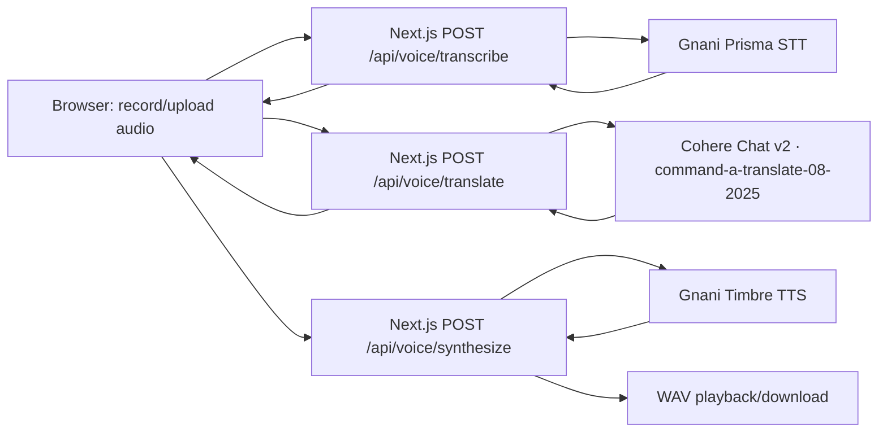

# Gnani AI Integration Notes

## Current status

This is the existing LingOSwap project with server-side routes for Gnani Prisma speech-to-text and Gnani Timbre text-to-speech. The route contracts were previously exercised once each against the live Gnani service under the earlier explicit authorization. Do not repeat those calls without new authorization. One live Cohere translation request has now succeeded through the local route under explicit authorization; it was not retried.

The browser-to-provider-to-browser workflow is not yet verified end to end. Do not describe the app as production ready.

## Architecture

Prisma recognizes speech, Cohere translates text, and Timbre synthesizes speech. Neither Gnani speech model is represented as a translation model.

## Translation API contract implemented

- Official docs: [Cohere Chat API v2](https://docs.cohere.com/reference/chat), [Command A Translate](https://docs.cohere.com/v2/docs/command-a-translate).
- Method and URL: `POST https://api.cohere.com/v2/chat`.
- Authentication: `Authorization: Bearer <server-side COHERE_API_KEY>`.
- JSON: `model: "command-a-translate-08-2025"`, `messages` (system translation instruction and user text/language labels), conservative generation settings.
- Success extraction: text parts from `message.content`, accepted only when `finish_reason` equals `COMPLETE`.
- Inputs validated: non-empty text, max 5,000 characters, two distinct supported locale codes.
- UI/API language contract: Hindi `hi-IN` ↔ English `en-IN`. Cohere’s model documentation lists both among supported languages. This does not verify the account’s model entitlement or its translation quality in this project.
- Timeouts and provider status classes are mapped to safe client errors; provider response bodies and user content are not logged or reflected.

## Gnani routes

- `POST /api/voice/transcribe`: multipart audio input and language code; validates supported extension, size, WAV sample rate/duration where inspectable; sends server-side `X-API-Key-ID` to Prisma and returns transcript plus supported response metadata.
- `POST /api/voice/synthesize`: JSON text, target language, and language-matched voice; sends server-side request to Timbre, returns binary WAV for browser playback/download.
- Model identifiers and voice options are defined in `src/lib/voice-contract.ts` and should be checked against current official docs/account before enabling additional choices.

## Environment and local operation

- `GNANI_API_KEY`: server-side only, required for Prisma and Timbre.
- `COHERE_API_KEY`: server-side only, required for translation and existing Cohere slang rewrite feature.
- `KV_REST_API_URL` and `KV_REST_API_TOKEN`: persistent production rate limiter configuration; missing values cause voice routes to fail closed with 503 in production. They are not required for loopback development; the in-memory fallback is process-local and is not suitable for a multi-instance deployment.
- `OPENAI_API_KEY`: not required by the current voice translation flow; retained only if another legacy helper needs it.
- Use ignored local environment files and host secret storage. Never put credentials in a `NEXT_PUBLIC_*` variable.

## Verification matrix

| Feature | Status |
|---|---|
| Prisma direct route contract | One prior live short request succeeded; not repeated in this turn. |
| Timbre direct route contract | One prior live short response returned WAV; not repeated in this turn. |
| Cohere translation | One live Hindi → English request returned HTTP 200 using `command-a-translate-08-2025`; route latency was 1.531 s. Returned: “Hello, my name is Many. I am creating a voice translation app for Indian languages.” Translation meaning was substantially preserved, but the name `manya` was rendered `Many`, so exact name spelling was not preserved. No retry. |
| Complete audio → transcript → translation → synthesis → playback | Not yet verified as one browser journey. |
| Hindi/English UI restriction | Implemented and route validation mock-tested. |
| Other full translated language pairs | Not implemented/enabled. |

Exactly one live Cohere request was made for the current translation verification. No Gnani calls, retries, OpenAI calls, or deployments occurred in that test. The remaining tests use mocked fetch responses and do not consume credits. See [competition readiness report](./COMPETITION_READINESS_REPORT.md) for blockers and safe browser checklist.
